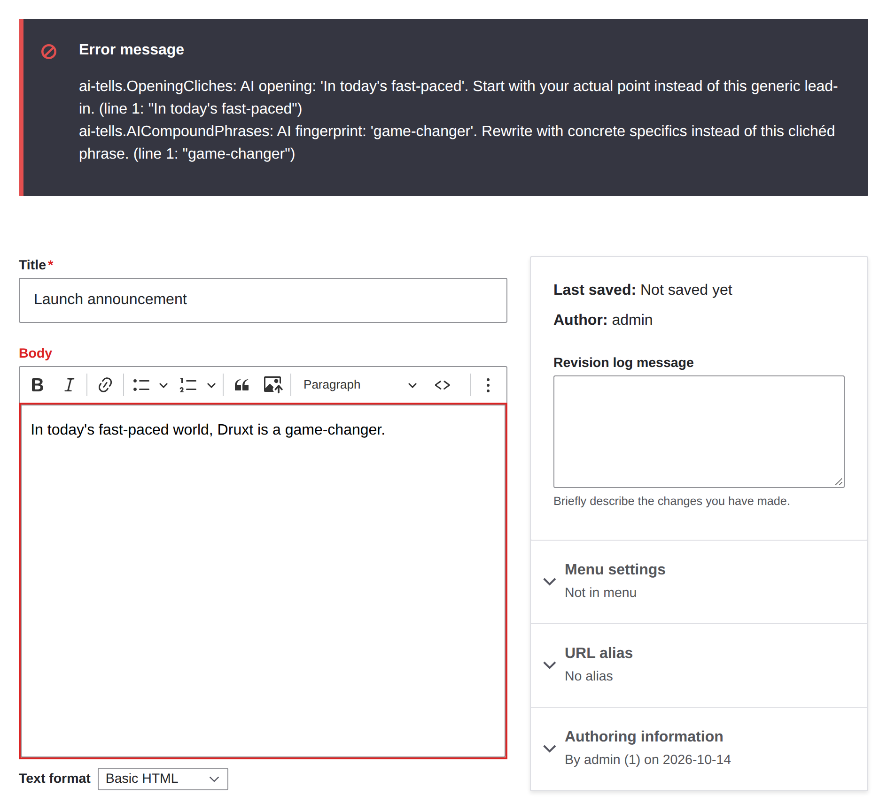
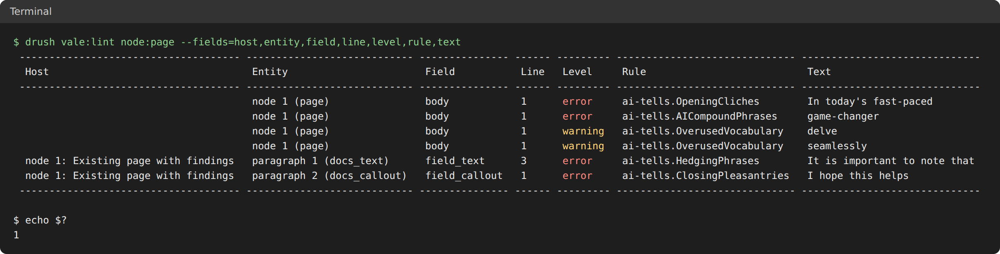

# Vale

[](https://git.drupalcode.org/project/vale/-/pipelines)
[](https://github.com/Decipher/vale/actions/workflows/test.yml?query=branch%3A1.0.x)
[](https://codecov.io/gh/Decipher/vale/branch/1.0.x)

Checks the prose in text fields against your style guide, with the
[Vale](https://vale.sh) linter.

Vale applies rules for style, tone and terminology. You can write your own, or
use a published style such as Microsoft, Google, write-good or proselint. This
module runs those rules on the text fields you choose, whenever a save
validates the content, as forms, JSON:API and REST do. An alert at error
level stops the save and is marked on the field. In publish-only mode, it
stops only the save that publishes. Warnings and suggestions are shown to the
author, and the content saves.



For a full description of the module, visit the
[project page](https://www.drupal.org/project/vale).

Submit bug reports and feature suggestions, or track changes in the
[issue queue](https://www.drupal.org/project/issues/vale).

## Table of contents

- Features
- Requirements
- Recommended modules
- Installation
- Configuration
- Usage
- FAQ
- Maintainers

## Features

- Checks content when it is validated on save: forms, JSON:API, REST and
  workspace publishing. Code that saves without validating, such as a
  migration, is not checked.
- Lists every error in a value at once, on the field it came from.
- Reads Markdown as Markdown and HTML as HTML, so code is not checked as
  prose.
- Caches results until the text or the styles change.

## Requirements

- PHP 8.3 or later
- Drupal 10.3, 11 or 12
- Vale 3, on every web server and in the CLI container, with the styles your
  `.vale.ini` uses

## Recommended modules

None are required. These are supported when they are installed:

- [Content Moderation](https://www.drupal.org/docs/core-modules-and-themes/core-modules/content-moderation-module)
  (core): publish-only mode follows the moderation state.
- [Workspaces](https://www.drupal.org/docs/core-modules-and-themes/core-modules/workspaces-module)
  (core): a workspace's changes can be checked before they are published.
- [Paragraphs](https://www.drupal.org/project/paragraphs): opted-in fields on
  paragraphs are checked, and publishing a page checks its paragraphs.

## Installation

1. Install the module with Composer, then enable it:

   ```bash
   composer require drupal/vale
   drush en vale
   ```

2. Install Vale:

   ```bash
   drush vale:install
   ```

   This downloads the latest Vale release for the machine it runs on, into
   `bin/` beside your web root, and checks it against the SHA-256 the release
   publishes. Add `--vale-version=3.24.0` to pin a version, or `--sha256` to
   check against a hash you trust. It needs an installed site, and works on
   Linux and macOS. Run it in the image or container that will run Vale. In a
   build with no database, download a
   [release](https://github.com/vale-cli/vale/releases) yourself and check its
   checksum.

3. Add a `.vale.ini` beside your web root, such as:

   ```ini
   StylesPath = styles
   Packages = Microsoft

   [*]
   BasedOnStyles = Vale, Microsoft
   ```

   Run `vale sync` beside it to download the styles, and deploy the `styles`
   directory with your site.

4. Point the site at both, in `settings.php`:

   ```php
   $settings['vale_binary'] = $app_root . '/../bin/vale';
   $settings['vale_config'] = $app_root . '/../.vale.ini';
   ```

5. Check **Reports > Status report**. The Vale entry shows the version and the
   number of rules in your styles.

If you enable the module through a config import, such as `drush deploy`,
Drupal does not install its optional config. Export `views.view.vale_findings`
and `system.action.node_vale_check_prose` with the rest of your
configuration, or the report page and the **Check prose with Vale** bulk
action are missing.

## Configuration

### Fields

In **Manage fields**, edit a field and open **Prose checks**, then select
**Check with Vale**. Any text or plain text field you add can be checked.
Base fields such as the title cannot, and a body's summary is not checked.
Each field can also:

- report only from a minimum level
- set any rule to its own level, or turn it off
- use a profile, a name that `.vale.ini` sections match

Values are linted under the name `<entity_type>.<bundle>.<field>`, with an
extension from the text format, so a `.vale.ini` section can apply to one
field:

```ini
[*.field_summary.*]
Microsoft.Contractions = NO
```

### Permissions

No role gets these by default, Drupal CMS's content editor included. Grant
them in **People > Permissions**.

| Permission | What it allows |
| --- | --- |
| Use the Vale check endpoint | `POST /vale/check`, which checks text before it is saved |
| View the prose linting report | The report and its CSV export, which quote text from all content, published or not |
| Scan content with Vale | The report's scan and the **Check prose with Vale** bulk action |

### Site settings

There is no settings form. Set these in `settings.php`, such as
`$config['vale.settings']['publish_only'] = TRUE;`.

| Key | Default | What it does |
| --- | --- | --- |
| `formats` | none | The extension for a text format, such as `markdown: md`, so Vale reads it as Markdown |
| `default_extension` | `html` | The extension for every other text format |
| `publish_only` | `FALSE` | When `FALSE`, any save with an error is refused. When `TRUE`, drafts save with their errors, and only the save that publishes is refused. Inside a workspace, every save of content it tracks is a draft, and the workspace's publish is the publishing save; content it does not track, which saves straight to Live, keeps the refusal. A paragraph saved by itself, such as over JSON:API, is a publishing save when it changes the revision a published host shows |
| `fail_closed` | `FALSE` | A save is refused when Vale cannot check its text, as it is for an error. Off, the save goes through with a notice |
| `workspace_mode` | `advise` | Before a workspace is published: `block` stops it on errors, `advise` lists the alerts, `off` skips the check. With `publish_only` on, `advise` stops on errors too, and on unchecked text while `fail_closed`, because the workspace's publish is the publishing save |
| `timeout` | `10` | Seconds one Vale run may take |
| `check_limit`, `check_window` | `120`, `60` | Check endpoint requests allowed per user, per this many seconds |

## Usage

### Drush

`drush vale:lint` checks stored content, such as every page with
`drush vale:lint node:page`, or a workspace's changes with `--workspace`. It
exits with 1 on an error, so a deploy can depend on it. A bundle with no field
checked by Vale is refused, so it never reads as a pass.



`--format=json` gives one full record per alert. `drush vale:check
node.page.body "Some text."` lints text, or standard input, as that field
would, with `--text-format` for its format. `vale:rules` and `vale:status`
show what is loaded.

### Content report

**Reports > Prose linting** lists the alerts in stored content, with
filters for bundle, level and rule, a link to each item, and a CSV export of
what the filters show. It needs Views.

Fill it with **Check content** on that page, which scans the bundles you pick
in a batch, or with `drush vale:lint --save` from cron or CI. You can also
check selected items with the **Check prose with Vale** bulk action on the
content overview. Saving or deleting content keeps its rows current.

### JSON:API

A write with an error is refused with a 422 that points at the field:

```json
{
  "errors": [
    {
      "title": "Unprocessable Content",
      "status": "422",
      "detail": "body.0.value: Body: Vale.Repetition: 'the' is repeated! (line 1: \"the the\")",
      "source": {
        "pointer": "/data/attributes/body/value"
      }
    }
  ]
}
```

All the errors in one value are in one entry, a line each. In publish-only
mode a refused publish points at `/data`. Other alerts are in the response's
`meta.vale`, as `{checked, alerts}`. Each alert has the entity's type, bundle
and UUID, the field and delta, and the rule, level, message, matched text,
line and columns. `checked` is false when Vale could not run.

### Check endpoint

`POST /vale/check` with a JSON body of `entity_type`, `bundle`, `field`,
`format` and `text` returns `{checked, publish_only, alerts}`, the alerts
that saving the text in that field would give. Each alert also has the
sentence around it.

Add `id` to check text for an entity that exists.

The user needs the **Use the Vale check endpoint** permission and the right
to edit that field. Without `id`, they also need the right to create that
bundle. With `id`, they need the right to edit that entity instead. With a
cookie session, send an `X-CSRF-Token` header from `/session/token`. Too many
requests from one user get a 429. At most four checks run at once across the
site, and a check past that gets a 503.

## FAQ

**Q: Why are the paths in `settings.php` and not in the admin UI?**

**A:** Vale's script rules run code, so a ruleset belongs in your codebase.
The module never accepts a binary path or a ruleset through the site.

**Q: Does it detect text written by AI?**

**A:** No. It checks style. Some Vale styles flag phrases that AI tools
overuse, and the module applies them like any other rule.

**Q: What happens if Vale is missing, times out or fails?**

**A:** Content saves, and the author is told it was not checked. When Vale
is missing or its configuration cannot be read, the status report also shows
a warning for the server it ran on. A timeout or a failed run shows only to
the author. `drush vale:lint` and the workspace `block` mode fail, so an
unchecked deploy does not pass. To refuse the save as well, set
`fail_closed`.

**Q: Does it check Canvas pages?**

**A:** No. Canvas keeps a page's text in component props, not in fields you
can opt in. Node fields on a Drupal CMS site are checked, including node
text that Canvas renders through a content template.

**Q: How much does the result cache hold?**

**A:** Results are kept in the `vale` cache bin for a week. On the database
cache backend, cron trims each bin to 5,000 rows, so a large site checks
some text again. Set `$settings['database_cache_max_rows']`, or put the bin
on Redis or Memcache.

## Maintainers

- Stuart Clark - [deciphered](https://www.drupal.org/u/deciphered)
