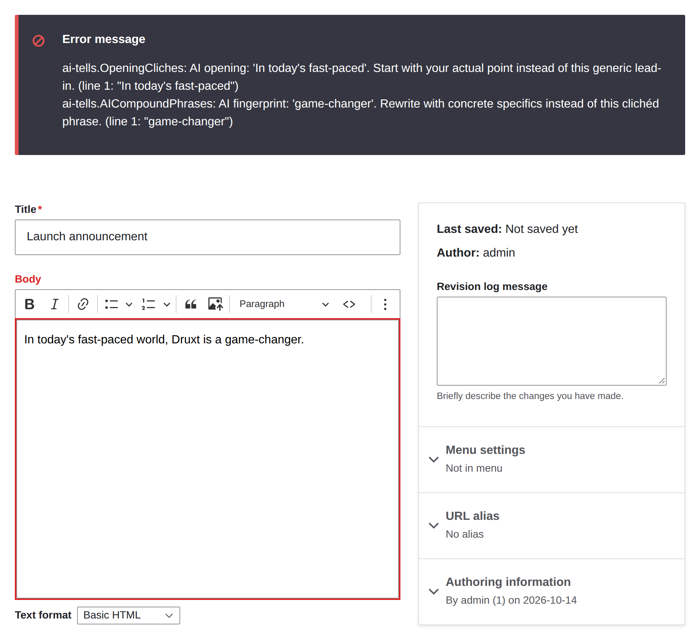
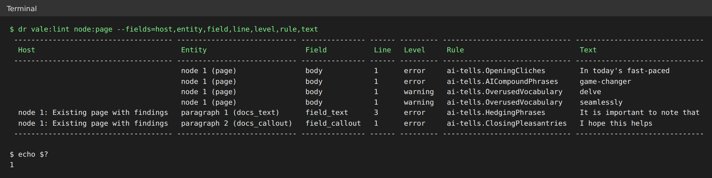

# Vale

[](https://git.drupalcode.org/project/vale/-/pipelines)
[](https://github.com/Decipher/vale/actions/workflows/test.yml?query=branch%3A1.0.x)
[](https://codecov.io/gh/Decipher/vale/branch/1.0.x)

Checks the prose in text fields against your style guide, with the
[Vale](https://vale.sh) linter.

Vale applies rules for style, tone and terminology. You can write your own, or
use a published style such as Microsoft, Google, write-good or proselint. This
module runs those rules on the text fields you choose, whenever a save
validates the content, as forms, JSON:API and REST do. An alert at error
level stops the save and is marked on the field. In publish-only mode, it
stops only the save that publishes. Warnings and suggestions are shown to the
author, and the content saves.



For a full description of the module, visit the
[project page](https://www.drupal.org/project/vale).

Submit bug reports and feature suggestions, or track changes in the
[issue queue](https://www.drupal.org/project/issues/vale).

## Table of contents

- Features
- Requirements
- Recommended modules
- Installation
- Configuration
- Usage
- FAQ
- Maintainers

## Features

- Checks content when it is validated on save: forms, JSON:API, REST and
  workspace publishing. Code that saves without validating, such as a
  migration, is not checked.
- Lists every error in a value at once, on the field it came from.
- Shows findings while the author types: marks in CKEditor 5, and a list
  under text areas and text fields.
- Reads Markdown as Markdown and HTML as HTML, so code is not checked as
  prose.
- Checks each translation in its own language, with Vale 3.27.0 or later.
- Caches results until the text or the styles change.

## Requirements

- PHP 8.3 or later
- Drupal 10.3, 11 or 12
- Vale 3, on every web server and in the CLI container, with the styles your
  `.vale.ini` uses. Checking languages other than English needs Vale 3.27.0
  or later.

## Recommended modules

None are required. These are supported when they are installed:

- [Content Moderation](https://www.drupal.org/docs/core-modules-and-themes/core-modules/content-moderation-module)
  (core): publish-only mode follows the moderation state.
- [Workspaces](https://www.drupal.org/docs/core-modules-and-themes/core-modules/workspaces-module)
  (core): a workspace's changes can be checked before they are published.
- [Paragraphs](https://www.drupal.org/project/paragraphs): opted-in fields on
  paragraphs are checked, and publishing a page checks its paragraphs.
- [Canvas](https://www.drupal.org/project/canvas) 1.13 or later, on Drupal
  11.3 or later: the text in the components of Canvas pages can be checked.
  See [Canvas pages](#canvas-pages).

## Installation

1. Install the module with Composer, then enable it:

   ```bash
   composer require drupal/vale
   vendor/bin/dr en vale
   ```

   `dr en` comes with Drush 15. With Drush 12, 13 or 14, run `drush en vale`.

2. Install Vale:

   ```bash
   vendor/bin/dr vale:install
   ```

   On a Drupal version without `dr`, run `drush vale:install` instead.

   This downloads the latest Vale release for the machine it runs on, into
   `bin/` beside your web root, and checks it against the SHA-256 the release
   publishes. Add `--vale-version=3.24.0` to pin a version, or `--sha256` to
   check against a hash you trust. It needs an installed site, and works on
   Linux and macOS. Run it in the image or container that will run Vale. In a
   build with no database, download a
   [release](https://github.com/vale-cli/vale/releases) yourself and check its
   checksum.

   From Vale 3.26.0 it also installs Vale's browser build, at the same
   version. That is Vale compiled to WebAssembly: `vale.wasm` and the
   `wasm_exec.js` that loads it. They go in `libraries/vale` under your web
   root, where the site finds them with no setting, and they are checked
   against the release's checksums file. `--wasm-dir` puts them somewhere
   else, `--wasm-sha256` checks them against a hash you trust, and
   `--no-wasm` installs the binary only. Older Vale versions have no browser
   build, so only the binary is installed. Deploy `libraries/vale` with your
   site, as you do the binary.

3. Add a `.vale.ini` beside your web root, such as:

   ```ini
   StylesPath = styles
   Packages = Microsoft

   [*]
   BasedOnStyles = Vale, Microsoft
   ```

4. Point the site at both, in `settings.php`:

   ```php
   $settings['vale_binary'] = $app_root . '/../bin/vale';
   $settings['vale_config'] = $app_root . '/../.vale.ini';
   ```

5. Download the styles that `.vale.ini` names:

   ```bash
   vendor/bin/dr vale:sync
   ```

   This runs Vale's sync with the site's configuration, so the styles land
   in its `StylesPath`. With Vale 3.27.0 or later, it also downloads the
   model for each of the site's languages, so `.vale.ini` need not name
   them. Deploy the `styles` directory with your site.

6. Check **Reports > Status report**. The Vale entry shows the version and the
   number of rules in your styles. The Vale browser build entry shows the
   browser build's version, and warns when it differs from the binary's, is
   older than 3.26.0, or is not under the web root. The Vale languages entry
   lists the site's languages, and names those with no model or no spelling
   dictionary.

If you enable the module through a config import, such as `drush deploy`,
Drupal does not install its optional config. Export `views.view.vale_findings`
and `system.action.node_vale_check_prose` with the rest of your
configuration, or the report page and the **Check prose with Vale** bulk
action are missing.

### Hosting

Vale runs wherever the site runs: on every web server, and wherever `dr` or
Drush runs, such as cron and SSH. Most hosts make the code read-only once it
is deployed, and give each server the same copy. So keep Vale, `.vale.ini`
and the styles in the codebase, and install them before the code is
deployed. The `settings.php` lines in step 4 then work on every server.

Vale 3.27.0 and later is a static Linux binary, so it needs no other
libraries, on Alpine too. Some earlier releases, such as 3.24.0, need glibc
and libstdc++.

`vale:install` and `vale:sync` need an installed site, so they cannot run in
a build with no database. This script does the same job with Vale alone. It
downloads a pinned release into `bin/`, checks its SHA-256, and downloads the
styles. Save it as `scripts/vale.sh` and run it from the project root:

```sh
#!/bin/sh
# Installs a pinned Vale into bin/ and downloads the styles .vale.ini names.
set -e
VERSION=3.28.1
SHA256=068954ad869ebec24b8dec6ebcd1cbb1fd5f5a83e966a35baedfae8b2cdc093a
ARCHIVE="vale_${VERSION}_Linux_64-bit.tar.gz"
curl -fsSLo "/tmp/$ARCHIVE" \
  "https://github.com/vale-cli/vale/releases/download/v$VERSION/$ARCHIVE"
echo "$SHA256  /tmp/$ARCHIVE" | sha256sum -c -
mkdir -p bin
tar -xzf "/tmp/$ARCHIVE" -C bin vale
bin/vale --no-global --config=.vale.ini sync
chmod -R a+rX styles
```

Take the SHA-256 from the release's `vale_<version>_checksums.txt`. For an
ARM server, use the `Linux_arm64` archive and its SHA-256. `uname -m` on the
server tells you which: `x86_64` or `aarch64`. Vale's sync makes the style
directories readable by their owner only, so the last line opens them to the
web server.

#### Lagoon

Run the script in the Dockerfiles of both the CLI image and the PHP-FPM
image, after the code is copied in. Drush runs in the CLI image and the site
in the PHP-FPM image, so each needs Vale. On Alpine, a Vale release before
3.27.0 also needs glibc support, such as the `gcompat` package.

#### Acquia Cloud Platform

You cannot install system packages on Acquia yourself, but you can add your
own executables to the code repository. Git keeps a file's execute bit, so
commit `bin/vale` with the bit set, with `.vale.ini` and the `styles`
directory. Run the script on 64-bit Linux first. On another system, download
the release and check it by hand, then run the sync with your own Vale:
`vale --no-global --config=.vale.ini sync`.

With Code Studio, you can run the script from `post-install-cmd` in
`composer.json` instead, as Acquia shows for front-end builds:

```json
"scripts": {
    "post-install-cmd": [
        "sh scripts/vale.sh"
    ]
}
```

#### Pantheon

Code is read-only on Test and Live. Integrated Composer runs
`composer install`, and Pantheon's support does not cover Composer scripts.
Quicksilver hooks run once the code is deployed and read-only. So commit `bin/vale`, with
`.vale.ini` and the `styles` directory, as for Acquia. Keep them out of
`vendor/`, which the build replaces. Pantheon does not document running your
own binaries, so check the status report on Dev, Test and Live.

#### Platform.sh and Upsun

The build hook can write to the application directory and download files,
and what it leaves there is deployed. It has no database, so run the script
there, in `.platform.app.yaml` or the application in `.upsun/config.yaml`:

```yaml
hooks:
  build: |
    set -e
    sh scripts/vale.sh
```

After the build, the application directory is read-only, so `vale:sync`
cannot run there. Change `.vale.ini` and redeploy instead.

## Configuration

### Fields

In **Manage fields**, edit a field and open **Prose checks**, then select
**Check with Vale**. Any text or plain text field you add can be checked.
Base fields such as the title cannot, and a body's summary is not checked.
Each field can also:

- report only from a minimum level
- set any rule to its own level, or turn it off
- use a profile, a name that `.vale.ini` sections match

Values are linted under the name `<entity_type>.<bundle>.<field>`, with an
extension from the text format, so a `.vale.ini` section can apply to one
field:

```ini
[*.field_summary.*]
Microsoft.Contractions = NO
```

### Languages

Vale reads English unless it is told otherwise. From Vale 3.27.0, the module
checks each value in the language of its translation, so a French
translation gets French sentence splitting and spelling. It sets
[`Lang`](https://docs.vale.sh/keys/lang) at the top of the configuration it
passes to Vale. A section of your `.vale.ini` that sets its own `Lang` still
wins. Values in English, **Not specified** and **Not applicable** are checked
with your `.vale.ini` as it is.

The configuration for each language is written to the temporary directory,
with an absolute `StylesPath`. Its file name holds a fingerprint of your
configuration and styles, so a change gets a new file.

Vale has models for French, German and Spanish. `vale:sync` downloads them
into `<StylesPath>/config/models`. Vale splits the sentences of any other
language by punctuation. Vale's spelling check needs a Hunspell dictionary
for the language, such as `fr.dic` and `fr.aff`, in
`<StylesPath>/config/dictionaries`. Without one, Vale skips the spelling
check in that language. The status report names the languages with no model
and those with no dictionary.

With a Vale older than 3.27.0, every value is checked in English, and the
status report says so.

### Canvas pages

A Canvas page keeps its text in the props of its components, not in text
fields, and Canvas pages have no **Manage fields**. So they have a settings
form of their own: **Configuration > Content authoring > Canvas page prose
checks**, at `/admin/config/content/vale/canvas`. It needs the **Administer
components** permission from Canvas.

**Check with Vale** turns the check on for every component. Each prop that
Canvas treats as plain or rich prose is checked. Lists of choices, links,
images and other values that are not prose are left out, as are block
components. The settings are those of a field, plus **Props not to check**:
prop names to leave out in every component, one per line, such as `id` or
`ariaLabel`.

Plain text props are linted as `.txt`, and rich text props with the extension
for their text format, `canvas_html_block` or `canvas_html_inline`. All
values are linted under the name `canvas_page.canvas_page.components`.

Publishing a page in Canvas validates it, so an error refuses the publish, as
it does for a field. Each error names its component and prop, such as
`Components > Hero > heading: ...`, and Canvas's review panel links it to the
component. With `publish_only` on, an unpublished page saves with its errors,
and the save that publishes it is refused. Outside Canvas, such as over
JSON:API, the error is on the page itself, so a PATCH that only publishes the
page is refused too. Each translation of a page is checked in its own
language.

The content report and `dr vale:lint canvas_page:canvas_page` show the
component and prop too. In the report, **Found in** reads
`> Components > Hero > heading`. On the command line, the field reads
`components > Hero > heading`, and JSON output adds the component instance's
UUID and the prop name by themselves. The CSV export has columns for both.

The settings are third-party settings on the
`core.base_field_override.canvas_page.canvas_page.components` configuration,
so they are exported with the rest of the site's configuration.

### Permissions

No role gets these by default, Drupal CMS's content editor included. Grant
them in **People > Permissions**.

| Permission | What it allows |
| --- | --- |
| Use the Vale check endpoint | `POST /vale/check`, which checks text before it is saved, and the configuration and styles the browser build reads |
| View the prose linting report | The report and its CSV export, which quote text from all content, published or not |
| Scan content with Vale | The report's scan and the **Check prose with Vale** bulk action |

### Browser build

If you ship `vale.wasm` and `wasm_exec.js` yourself, put them in a
directory under the web root and name it in `settings.php`:

```php
$settings['vale_wasm'] = 'libraries/vale-wasm';
```

The setting is a path from the web root, an absolute path under it, or a
stream URI such as `public://vale`. Use the files from one release archive,
`vale_<version>_wasm.tar.gz`. The status report reads the version from
`vale.wasm` itself, so no other file is needed.

Browsers load both files with `?v=` and the version on the URL, so a new
version gets new URLs. Let your web server cache them for a long time, and
serve `vale.wasm` as `application/wasm`, compressed: it is about 38 MB, and
9.5 MB with gzip. Drupal's `.htaccess` caches files for two weeks. On nginx,
add `wasm` to the extensions your static file rule caches.

### Configuration for browsers

The browser build reads nothing from the server by itself, so the module
serves it the site's configuration. Each route needs the **Use the Vale
check endpoint** permission.

| Route | What it gives |
| --- | --- |
| `/vale/config/{langcode}` | The `.vale.ini` for that language, with `StylesPath = /styles` and `Lang` set as for the CLI |
| `/vale/styles` | The styles as a zip, as Vale packages them |
| `/vale/models/{langcode}` | That language's model and spelling dictionary as a zip |

A zip holds what `StylesPath` holds, at its top, so it loads at `/styles`
in the browser build's filesystem. The styles zip leaves out
`config/grammars`, which Vale uses only for source code, and the models and
dictionaries of languages other than English, which come by language. Hidden
files, and links that point out of `StylesPath`, are never served. Nothing
else on the server is served, and the paths stay in `settings.php`.

Each zip is cached until the styles change. Browsers get an `ETag`, so they
download it again only when it changes. A zip asked for with the styles'
fingerprint, as `?v=` on its URL, is kept by the browser without asking
again, because changed styles have another fingerprint. The module's own
pages ask for the zips that way.

The status report and the field's **Prose checks** settings link to the
styles zip. The [Vale browser extension](https://github.com/vale-cli/vale-web)
imports it as a package, with **Upload archive**, so an editor can check
their writing against the site's styles on any site. For its
configuration, paste in what `/vale/config/en` gives, as it is.

### Site settings

There is no settings form. Set these in `settings.php`, such as
`$config['vale.settings']['publish_only'] = TRUE;`.

| Key | Default | What it does |
| --- | --- | --- |
| `formats` | none | The extension for a text format, such as `markdown: md`, so Vale reads it as Markdown |
| `default_extension` | `html` | The extension for every other text format |
| `publish_only` | `FALSE` | When `FALSE`, any save with an error is refused. When `TRUE`, drafts save with their errors, and only the save that publishes is refused. Inside a workspace, every save of content it tracks is a draft, and the workspace's publish is the publishing save; content it does not track, which saves straight to Live, keeps the refusal. A paragraph saved by itself, such as over JSON:API, is a publishing save when it changes the revision a published host shows |
| `fail_closed` | `FALSE` | A save is refused when Vale cannot check its text, as it is for an error. Off, the save goes through with a notice |
| `workspace_mode` | `advise` | Before a workspace is published: `block` stops it on errors, `advise` lists the alerts, `off` skips the check. With `publish_only` on, `advise` stops on errors too, and on unchecked text while `fail_closed`, because the workspace's publish is the publishing save |
| `timeout` | `10` | Seconds one Vale run may take |
| `check_limit`, `check_window` | `120`, `60` | Check endpoint requests allowed per user, per this many seconds |

## Usage

### Command line

The commands run under core's `dr`, such as `vendor/bin/dr vale:lint`. On a
Drupal version without `dr`, run them with Drush 12, 13 or 14 instead, such
as `drush vale:lint`. They take the same arguments and options either way.

`dr vale:lint` checks stored content, such as every page with
`dr vale:lint node:page`, or a workspace's changes with `--workspace`. It
exits with 1 on an error, so a deploy can depend on it. A bundle with no field
checked by Vale is refused, so it never reads as a pass.



`--format` takes `table`, the default, `json` or `csv`. JSON and CSV give
one full record per alert, and `--fields` picks the fields by name or label,
such as `--fields=entity,rule,message`. `dr vale:check node.page.body "Some
text."` lints text, or standard input, as that field would, with
`--text-format` for its format. `vale:rules` and `vale:status` show what is
loaded, and `vale:sync` downloads the styles again after you change
`.vale.ini`.

### Content report

**Reports > Prose linting** lists the alerts in stored content, with
filters for bundle, level and rule, a link to each item, and a CSV export of
what the filters show. It needs Views.

Fill it with **Check content** on that page, which scans the bundles you pick
in a batch, or with `dr vale:lint --save` from cron or CI. You can also
check selected items with the **Check prose with Vale** bulk action on the
content overview. Saving or deleting content keeps its rows current.

### JSON:API

A write with an error is refused with a 422 that points at the field:

```json
{
  "errors": [
    {
      "title": "Unprocessable Content",
      "status": "422",
      "detail": "body.0.value: Body: Vale.Repetition: 'the' is repeated! (line 1: \"the the\")",
      "source": {
        "pointer": "/data/attributes/body/value"
      }
    }
  ]
}
```

All the errors in one value are in one entry, a line each. In publish-only
mode a refused publish points at `/data`. Other alerts are in the response's
`meta.vale`, as `{checked, alerts}`. Each alert has the entity's type, bundle
and UUID, the field and delta, and the rule, level, message, matched text,
line and columns. `checked` is false when Vale could not run.

### Check endpoint

`POST /vale/check` with a JSON body of `entity_type`, `bundle`, `field`,
`format` and `text` returns `{checked, publish_only, alerts}`, the alerts
that saving the text in that field would give. Each alert also has the
sentence around it.

Add `id` to check text for an entity that exists. Add `langcode`, one of
the site's languages, to read the text in that language, as a save of that
translation does. Without it, the text is read as English.

The user needs the **Use the Vale check endpoint** permission and the right
to edit that field. Without `id`, they also need the right to create that
bundle. With `id`, they need the right to edit that entity instead. With a
cookie session, send an `X-CSRF-Token` header from `/session/token`. Too many
requests from one user get a 429. At most four checks run at once across the
site, and a check past that gets a 503.

### Findings while editing

Authors see findings while they type, in each field Vale checks, so they
can fix them before they save. Vale checks the text after a pause in
typing, in the same language, text format and field settings that the save
uses.

- **CKEditor 5:** add the **Vale findings** button to the toolbar in the
  text format's settings. Each finding is underlined in the text, and
  hovering it, or moving the caret into it, shows the rule, the message and
  a link about the rule. The button hides the marks and shows them again,
  and says so while the first check runs.
- **Text areas and text fields:** a section under the field says how many
  findings there are, and how many are errors, warnings and suggestions. It
  opens by itself only when the text has an error, and then stays as the
  author leaves it. Open, it lists the findings in a table, with the errors
  first, that scrolls after about five rows. Select a finding's text to
  select it in the field. A text with no findings, a text being checked and
  a text that could not be checked each get one line and no section. This
  also covers a formatted field whose text format has no editor. A field
  with a text editor has no section, as its findings are in the text.

The first findings come from the server, or from Vale's browser build,
whichever answers first, so the author does not wait for the build to
download. A screen reader is told when a field's findings change, with
`Drupal.announce()`. The section and the card use the admin theme's own
markup and colours, so they follow Claro, and Gin's dark mode.

Each widget of a checked field has a **Show findings while editing** setting
on the form display, so a form mode can turn it off. It is on by default.
The author needs the **Use the Vale check endpoint** permission. The summary
of a text field with a summary is not checked while editing.

The marks are advice. The save still checks every value on the server.

Editors who use the [Vale browser
extension](https://github.com/vale-cli/vale-web) would see each finding
twice. Set the extension to **On demand** on the site, or load the site's
styles into it from `/vale/styles` (see
[Configuration for browsers](#configuration-for-browsers)), so both show
the same findings.

### Checking in the browser

The `vale/browser` library checks text in the browser, with Vale's browser
build, so an editor plugin can check as the author types. It loads
`vale.wasm` in a Web Worker the first time it is used, with the
configuration, styles and models the module serves for browsers. Each value
is checked in its own language, with the same name, extension and field
settings that a save uses, so it gets the alerts a save would give.

The styles download while the browser build loads. A language's
configuration and model are asked for together, the first time a value in
that language is checked, and a language with no model is not asked for
one. The browser keeps the styles and each model until the styles change.

Until the browser build has loaded, the library also sends each value to
`POST /vale/check`, and takes whichever answers first.

The library checks a value with `POST /vale/check` alone, in the value's
language, when:

- the browser build is missing;
- the browser build fails to load;
- the worker dies, or does not answer within 30 seconds;
- the browser build fails to check that value, such as when a style or a
  language's configuration fails to download.

After any of the first three, the library sends every later value on the
page to the server. After the last, it tries the browser build again with
the next value, and downloads again what failed.

An editor plugin attaches the library and a field's settings to its
element, then lints a value:

```php
use Drupal\Core\Render\BubbleableMetadata;
use Drupal\vale\ValeBrowser;

$element['#attached'] = BubbleableMetadata::mergeAttachments(
  $element['#attached'] ?? [],
  \Drupal::service(ValeBrowser::class)->attachments($field),
);
```

```js
const { checked, alerts } = await Drupal.vale.lint({
  entityType: 'node',
  bundle: 'page',
  field: 'body',
  format: 'basic_html',
  langcode: 'fr',
  text: '<p>Some text.</p>',
});
```

`id` adds the entity's UUID to each alert, `entityId` lets the server check
know the entity, and `delta` gives the value's delta. The alerts have the
shape of `meta.vale` in JSON:API. The user needs the **Use the Vale check
endpoint** permission.

`Drupal.vale.lint()` rejects when:

- the field is not attached with `ValeBrowser::attachments()`, or Vale does
  not check it;
- the value goes to `POST /vale/check` and that fails, such as with a 403
  when the user may not check text for that field or entity, a 429 when
  they have sent too many checks, or a 503 when Vale is busy.

The error's message gives the HTTP status, such as `Vale check: HTTP 429`.
Catch it, and try again later for a 429 or a 503.

The save is still the authority. The server checks every save with the
CLI, so text that skips the browser check cannot publish an error.

In the browser, Vale reads a value as `input./<name>.<extension>`, so only
a `.vale.ini` section that starts with `*`, such as `[*.field_summary.*]`,
matches a field there. A section such as `[docs_callout.md]` or
`[node.page.*]` matches on the server only.

## FAQ

**Q: Why are the paths in `settings.php` and not in the admin UI?**

**A:** Vale's script rules run code, so a ruleset belongs in your codebase.
The module never accepts a binary path or a ruleset through the site.

**Q: Does it detect text written by AI?**

**A:** No. It checks style. Some Vale styles flag phrases that AI tools
overuse, and the module applies them like any other rule.

**Q: What happens if Vale is missing, times out or fails?**

**A:** Content saves, and the author is told it was not checked. When Vale
is missing or its configuration cannot be read, the status report also shows
a warning for the server it ran on. A timeout or a failed run shows only to
the author. `vale:lint` and the workspace `block` mode fail, so an
unchecked deploy does not pass. To refuse the save as well, set
`fail_closed`.

**Q: Does it check Canvas pages?**

**A:** Yes, with Canvas 1.13 or later on Drupal 11.3 or later. Turn it on
in **Canvas page prose checks**, as described under Canvas pages above. Node
fields that Canvas renders through a content template are checked as fields.

**Q: How much does the result cache hold?**

**A:** Results are kept in the `vale` cache bin for a week. On the database
cache backend, cron trims each bin to 5,000 rows, so a large site checks
some text again. Set `$settings['database_cache_max_rows']`, or put the bin
on Redis or Memcache.

## Maintainers

- Stuart Clark - [deciphered](https://www.drupal.org/u/deciphered)
